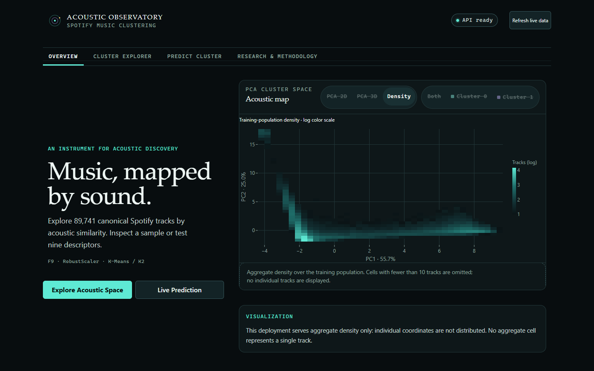

# Acoustic Observatory · Spotify Music Clustering

An interactive scientific music-intelligence application that turns unsupervised
acoustic clustering research into an explorable observatory. One FastAPI backend
serves the trusted deployment model and versioned, checksummed visualization
artifacts; one Gradio frontend renders the experience with Plotly and an optional
Three.js constellation.



The screenshots in this repository were captured in **aggregate** visualization
mode, so no per-track coordinates appear in committed evidence. The owner
approved public per-track coordinates and 3D on 2026-11-12; the public deployment
serves the points artifact over its private dataset, and the artifact is never
committed to Git.

## What the application does

- **Overview:** a research-oriented landing experience with an interactive
  cluster-space preview beside a compact introduction, a model fact sheet, the dominant
  instrumentalness finding and clear navigation.
- **Cluster Explorer:** a genuine PCA 2D/3D Plotly Explorer with zoom/pan/rotate,
  hover, cluster filtering, point selection, nearest sampled tracks in fitted
  scaled F9 space, a log-scaled aggregate density view and an optional GPU
  constellation view. The Plotly views are the scientific primary.
- **Predict Cluster:** grouped nine-descriptor form, real FastAPI inference, a
  prominent result card with both centroid distances, the current cluster profile
  and explicit "not a probability" language. Invalid input clears stale output.
- **Research & Methodology:** authorized data and preparation, F9/Robust/K-Means,
  archived historical evidence clearly separated from deployment results,
  controlled comparisons, interactive figures and explicit limitations.

## Scientific boundaries

- Only the Maharshi Pandya Spotify Tracks Dataset snapshot with SHA-256
  `b202fa49909b2d5cef71a04b1d21243cfeb36414535f2ca9272aa646721177bd` is
  authorized: 114,000 raw rows → **89,741 canonical tracks**.
- The deployed model is the approved **deployment-v1** F9/RobustScaler/K-Means/K2
  refit (`spotify-f9-robust-kmeans-k2-v1`). It is a separate identity from the
  historical final estimator. Historical equivalence is **NOT VERIFIED**.
- The historical Holdout remains closed. It was not reopened, rerun or extended.
  Historical metrics are labeled archived evidence only and are never attached to
  deployment predictions.
- Clusters are acoustic groups, not genres or listener moods. Centroid distances
  are Euclidean distances in fitted scaled space, not probabilities. The
  instrumentalness dominance (97.30% of between-cluster SS in the current
  artifact) is stated explicitly.
- PCA coordinates are visualization-only. They are not the model's training
  coordinates and are not used to assign clusters.
- Data license: ODbL 1.0. The approved public deployment serves a 6,000-track
  points sample (coordinates and F9 rows, no track identifiers) with ODbL
  attribution; deployments without that approval must use the aggregate
  artifact.

## Architecture

```text
Browser
  │  HTTPS / WebSocket (Gradio)
  ▼
Gradio frontend (7860) ──HTTP/JSON──▶ FastAPI backend (8000)
  │                                      │
  │  Plotly.js / constellation.js        ├─ trusted deployment-v1 model bundle
  │  served from reviewed assets         ├─ visualization artifact (points or aggregate)
  ▼                                      └─ research comparison artifact
Interactive UI

Offline preparation (operator machine, never in requests):
authorized CSV + trusted bundle ─▶ PCA/sample/occupancy artifacts
                                └▶ controlled training-population comparison
```

- [Architecture](docs/ARCHITECTURE.md) owns module boundaries and data flow.
- [Visualization pipeline](docs/VISUALIZATION.md) owns PCA artifacts, sampling,
  neighbor space and public/private policy.
- [Research design](docs/RESEARCH.md) owns evidence provenance and comparisons.
- [Design system](docs/DESIGN.md) owns tokens, responsive behavior and a11y.
- [Model serving](docs/MODEL_SERVING.md) owns the trusted artifact contract.
- [API](docs/API.md) owns endpoints, schemas and errors.
- [Web application](docs/WEB.md) owns the UI, interactions and browser checks.
- [Deployment](docs/DEPLOYMENT.md) owns container and operations guidance.

## Quick start (Windows PowerShell, Python 3.12)

```powershell
py -3.12 -m venv .venv
.\.venv\Scripts\python.exe -m pip install --upgrade "pip>=26.2.2"
.\.venv\Scripts\python.exe -m pip install -e ".[api,web,dev]"
```

The trusted model bundle is expected at `artifacts/deployment-v1`. It is not
rebuilt by this application. A separately authorized new deployment refit uses
`scripts/export_model.py` with a new output directory; existing artifacts are
never overwritten:

```powershell
.\.venv\Scripts\python.exe scripts/export_model.py --dataset dataset.csv `
  --output artifacts/deployment-v2 --profile deployment-v1
```

Prepare the visualization and research artifacts from the authorized local CSV
(new-only outputs; the raw CSV and all artifacts stay gitignored):

```powershell
.\.venv\Scripts\python.exe scripts/prepare_visualization.py `
  --dataset dataset.csv --model-dir artifacts/deployment-v1 `
  --output artifacts/visualization-v1 --mode points
.\.venv\Scripts\python.exe scripts/prepare_visualization.py `
  --dataset dataset.csv --model-dir artifacts/deployment-v1 `
  --output artifacts/visualization-public-v1 --mode aggregate
.\.venv\Scripts\python.exe scripts/prepare_research.py `
  --dataset dataset.csv --model-dir artifacts/deployment-v1 `
  --output artifacts/research-v1
```

Terminal 1 (backend):

```powershell
$env:SPOTIFY_MODEL_DIR = (Resolve-Path "artifacts/deployment-v1").Path
$env:SPOTIFY_VISUALIZATION_DIR = (Resolve-Path "artifacts/visualization-v1").Path
$env:SPOTIFY_RESEARCH_DIR = (Resolve-Path "artifacts/research-v1").Path
.\.venv\Scripts\python.exe -m uvicorn spotify_cluster.api.app:app --host 127.0.0.1 --port 8000
```

Terminal 2 (frontend):

```powershell
$env:SPOTIFY_API_BASE_URL = "http://127.0.0.1:8000"
.\.venv\Scripts\python.exe -m spotify_cluster.web.app
```

Open <http://127.0.0.1:7860>. The frontend binds loopback by default; it accepts
`SPOTIFY_WEB_HOST` (loopback or `0.0.0.0` only) and `SPOTIFY_WEB_PORT` for
container/reverse-proxy use. Stop both with Ctrl+C.

## Checks

```powershell
.\.venv\Scripts\python.exe -m pytest -q
.\.venv\Scripts\python.exe -m pytest -q tests/test_api_real_model.py --run-real-api
.\.venv\Scripts\python.exe -m ruff check .
.\.venv\Scripts\python.exe -m ruff format --check .
.\.venv\Scripts\python.exe -m build
```

Normal tests use deterministic software fixtures and need neither the private
dataset nor model artifacts. The real-API test requires the trusted bundle. The
browser verification used Playwright against the live local services; see
[WEB.md](docs/WEB.md). The wheel includes the built constellation bundle and its
third-party license; the Plotly browser asset is served from the installed
`plotly` package.

## Deployment

`Dockerfile` + `compose.yaml` prepare a non-root container pair with health
checks, read-only mounts and the aggregate public visualization by default.
`deploy/nginx.conf.example` sketches TLS and rate limiting. `render.yaml` and
`deploy/render/Dockerfile` deploy the approved public points mode to a Render
free web service, enabling 2D/3D Explorer views over a 6,000-track sample with
no track identifiers and ODbL attribution. Private artifacts are downloaded from
the Hugging Face dataset with an `HF_TOKEN` secret. The owner approved public
per-track coordinates on 2026-11-12. Free Hugging Face Docker Spaces require a
PRO subscription (HTTP 402 as of 2026-11-12). The existing service status and operator release route are recorded in
[DEPLOYMENT.md](docs/DEPLOYMENT.md).

## Repository boundaries

The raw `dataset.csv`, the original notebook, fitted bundles, verification
samples and visualization/research artifacts are ignored by Git. The abandoned
repository is not used. `plans/` preserves historical delivery evidence and
`docs/` owns current implementation guidance. LLM/browser assets are pinned;
`scripts/constellation/` contains the reproducible Three.js build source and
[third-party notices](src/spotify_cluster/web/static/THIRD_PARTY_LICENSES.txt).
